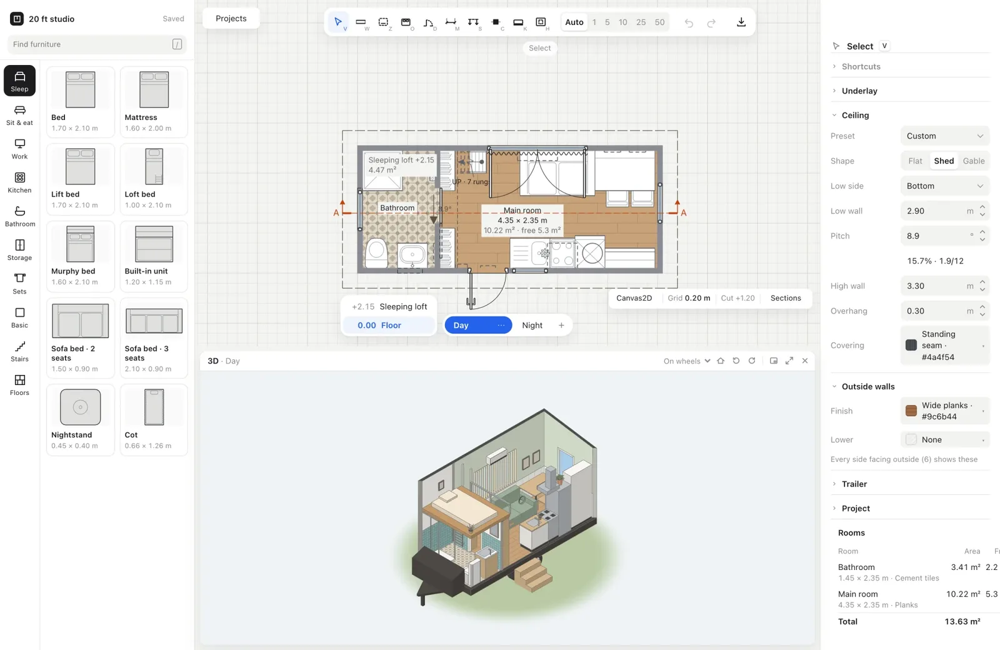
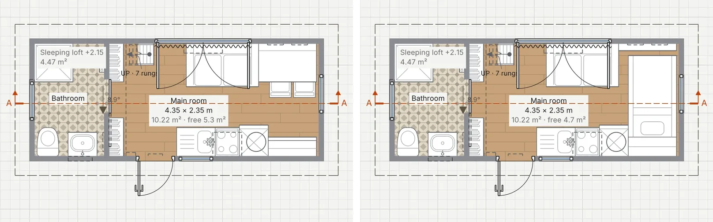

# Flatmate

Draw a home as a 2D plan and see it in 3D. A home planner for tiny houses, flats and small homes, in the browser.



You draw walls, rooms, doors and windows, furniture, lofts, stairs and the roof on a plan. Each one is a shape with a height range, and Flatmate builds the 3D view from that, next to the plan. You never model in 3D: you edit on the plan and the 3D view follows. [PHILOSOPHY.md](PHILOSOPHY.md) explains why it works this way and what it leaves out on purpose.

**A pet project.** I build Flatmate to learn, and I try to make it useful for people with a real home to plan. It is written by one developer working with coding agents, mostly Claude Code.

**Status: early.** It runs on your own machine. The server upgrades an older drawing when it opens it, but while the versions are 0.x the stored format may still change in a way that old drawings can't follow.

## What you can do

- **Draw the shell.** Walls with real thickness that join at their corners, rooms that show their clear size and area, columns, beams and named areas. Type a length while you draw, in metres or in feet and inches.
- **Doors, windows and stairs.** Swing, sliding, pocket and folding doors, casement windows, open passages and curtains. Straight, L-shaped, winder and spiral stairs, storage steps and ladders, drawn from the edge of a loft.
- **Furniture that fits.** Beds, sofas, tables, kitchens, bathrooms, storage, pictures, mirrors and plants, in standard sizes. A piece turns its back to the wall it touches and is refused where it doesn't fit.
- **Layouts.** The walls are shared and only the furniture moves. A Murphy bed is closed by day and open at night, and the free floor of each layout is measured.

  

- **Heights.** Lofts and platforms, half walls, a flat, shed or gable roof. A desk fits under a loft bed, and a bed that would hit the ceiling is refused.
- **Finishes.** Colours, wood, tiles and brick on each side of a wall, floor finishes, and the roof's covering.
- **Tiny houses on wheels.** The trailer, its wheel wells and the steps at the doors.
- **Trace a plan you already have.** Put a picture of a plan under the drawing, set its scale with two clicks, and draw over it.
- **Print it.** PDF sheets to scale with a title block, one per layout or section, plus PNG and SVG.
- **Edit together.** Several people edit the same drawing from their browsers. Everyone's cursor shows, and every edit appears for everyone at once.
- **Work with Claude.** An MCP server gives Claude the same tools and the same rules as a person.

## Run it

Requirements: Node 22 or later and pnpm 10.

```bash
git clone https://github.com/paull78/flatmate.git
cd flatmate
pnpm install
pnpm start
```

Then open http://localhost:5173/?name=Alice. The first time, the project list holds five sample houses, ready to open. Open a second window as http://localhost:5173/?name=Bob to edit the same drawing as someone else.

`pnpm start` runs the collaboration server and the web app together. Drawings are saved as JSON files in `packages/server/data/`.

[docs/try-it.md](docs/try-it.md) walks through the editor step by step, and lists the other commands.

## Use with Claude

`packages/mcp` is an MCP server. Claude edits the drawing as one more collaborator, through the same editor core and the same server rules as the browser windows.

Start the app first, then add the server to Claude Code from the repository root:

```bash
claude mcp add flatmate -- pnpm --silent --dir "$PWD" mcp
```

The Claude Desktop configuration is in [docs/try-it.md](docs/try-it.md#claude-desktop).

## Architecture

A TypeScript monorepo with a portable core and thin shells around it. Dependencies point inward only, and a check in `pnpm check` enforces it.

```
shells      web (React, Canvas2D, WebGL2, WebGPU) · server (Node, JSON files) · mcp (Claude's tools)
   │
@fm/editor  how a person edits: update(state, event, host) → { state, effects }
   │        no DOM, no network
@fm/domain  what a valid drawing is: pure functions, commands and invariants
```

- **The domain** decides what a valid home is. A wall that would cross another, or a bed that would hit the ceiling, is refused there, whether a person or Claude made the edit.
- **The editor** receives events and returns effects as plain data, so the same code runs in the browser, in tests and inside the MCP server.
- **The server** is the source of truth for collaboration. It accepts one edit at a time per project, the first writer wins, and nothing is merged.

[docs/architecture.md](docs/architecture.md) has the packages, how collaboration works and how it is tested. What each feature does is in [docs/specs/](docs/specs/README.md), one short document per topic, and [AGENTS.md](AGENTS.md) holds the rules every coding agent follows here.

To run the checks:

```bash
pnpm check    # types, lint, dependency rules, unit and integration tests
pnpm e2e      # Playwright in Chromium
```

## Roadmap

There are no dates. These are the next things on the list, roughly in order:

- lights and fans, as pieces on the ceiling and the walls;
- a fireplace with its chimney;
- roof windows, a roof terrace and the A-frame house;
- pieces outside the walls, such as an outdoor AC unit;
- dropped ceilings over part of a room;
- furniture drawn from your own outline;
- homes on several floors;
- in the 3D view: zoom, pan and perspective, shadows, and see-through glass.

The full list is in the [roadmap](docs/specs/roadmap.md).

## Limits

- No authentication. The server binds to `127.0.0.1` and refuses other sites' pages, so only your machine reaches it. Setting `HOST` to another address opens it to other machines, where anyone who reaches the port can read, change and delete every project.
- No arc walls, no walls crossing another wall in its interior, no rooms nested inside rooms.
- No walk paths: only use zones and door swings are checked, as warnings.
- No offline editing.
- Only Chromium is tested, so Safari may not work.

## Licence

Flatmate is free software under the [GNU Affero General Public License v3.0](LICENSE): you can use, study, change and share it. If you change it and let others use your version over a network, you must offer them its source under the same licence. The bundled Inter font is under the [SIL Open Font License](packages/editor/fonts/OFL.txt).
