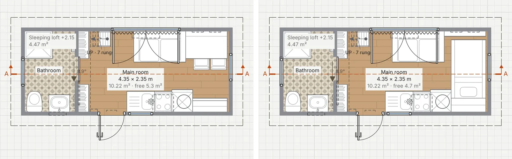

# Try it

A walk through the editor, step by step. Start the app first (`pnpm install`, then `pnpm start`) and open two windows side by side: http://localhost:5173/?name=Alice and http://localhost:5173/?name=Bob.

## Walls, rooms and two people

1. As Alice, create a project called "Apartment", then open it as Bob. Each window shows the other person's cursor, and each edit appears in both.
2. Press `W` and click the origin. Holding `Shift`, move right, type `6` and press `Enter`. Do the same with `4` up and `6` left, then click the first joint to close the room.
3. Still holding `Shift`, draw a divider between the midpoints of the bottom and top walls. The midpoint snap makes both ends exact, and the walls split where the divider meets them.
4. Press `Z` and click inside each room: each gets a tag with its clear area, 10.64 m² (walls are 0.20 m thick). Rename a room in the panel on the right.
5. Press `V` and select the right wall. The length shown on its inside is the clear length between the other walls' faces (3.80). Click it: the label turns into a field. Type `3.3` and press `Enter`: the top-right corner moves down and both areas update.
6. Drag that corner across the divider: the preview turns red and snaps back when you let go.
7. As Alice, move a joint twice and undo both moves. Once Bob edits that joint, Alice's redo is unavailable, with a note that the drawing changed remotely.

## Layouts: Day and Night

A layout is one arrangement of the furniture; walls, rooms, doors and windows are shared by all layouts. Each layout is checked on its own: furniture must stay inside its room and off the walls and other furniture (refused, like a bad wall move), and use zones and door swings that something blocks show in orange (a warning only). The room tag shows the free floor of the layout you are looking at.



1. Draw a 5 × 4 m room and label it with `Z`. Press `D` and click the bottom wall for a door. In the menu beside the tools, which shows "Swing door", choose Casement window and click the same wall again for a window.
2. Pick Murphy bed in the furniture list on the left (the Sleep group): a see-through ghost follows the pointer, turns its back to a wall it touches, and is red where it would not fit. Click below the top wall. Add a Folding table from the Sit & eat group, select it with `V` and set its Configuration to Open in the panel on the right. Rename the layout in the pill at the bottom to "Day".
3. Click `+` in the pill: a copy of the layout opens. Call it "Night", set the bed to Open and the table to Folded. Click Day and Night to flip between them: the furniture glides, and the free floor in the tag changes.
4. Select the bottom wall: on its inside, under its clear length, a chain of clear dimensions runs from the inner corner to the door, the window and the far corner. Click any piece and type a number to move the door or window, or change its width.
5. Press `M`, click two inner corners and then a point beside them: a dimension line measures the distance between the corners, and it shows in every layout. Press `V` and drag one of those corners: the value follows.

## Claude Desktop

The README has the command for Claude Code. For Claude Desktop (`claude_desktop_config.json`; use the absolute path of `pnpm` from `which pnpm` if Claude Desktop does not find it):

```json
{
  "mcpServers": {
    "flatmate": {
      "command": "pnpm",
      "args": ["--silent", "--dir", "/absolute/path/to/flatmate", "mcp"]
    }
  }
}
```

The server lists its tools to any MCP client. Coordinates are metres with y up. Each edit waits for the server and returns the updated drawing, or the reason it was refused ("Walls can't cross", "Someone else changed this first"); Claude's cursor shows where it last edited. `FM_SERVER_URL` and `FM_NAME` override the server and the display name.

## Renderers

The renderer chip in the canvas's bottom right corner switches between Canvas2D (the default) and a WebGL2 SDF renderer live; `?renderer=webgl` starts with WebGL, and `?renderer=webgpu` with WebGPU. If WebGL2 is missing or its context is lost, the app falls back to Canvas2D and says so.

## More commands

| Command | What it does |
|---------|--------------|
| `pnpm seed:samples` | adds any sample house that's missing from the project list; `pnpm start` adds them all by itself to a data folder with no projects |
| `pnpm seed` | adds a "Sample apartment" project (the room after step 4 of "Try it"); run it before starting the server |
| `pnpm seed:grid [N]` | adds a "Grid N×N" project of N × N labelled 3 m rooms (default 30; 50 gives 5,100 walls) for speed tests; run it before starting the server. Open any drawing with `?perf` to see update and draw times |
| `pnpm try-it` | replays steps 2 to 6 of "Try it" in the headless editor, with no browser, one narrated test per step |
| `pnpm build-room` | builds a 4 × 5 m room with a divider through the domain API only and prints its two areas |
| `pnpm check` | typecheck, lint, dependency rules and all Vitest unit and integration tests |
| `pnpm e2e` | Playwright tests in Chromium (install the browser once with `pnpm --filter @fm/web exec playwright install chromium`) |
| `pnpm dev:server` | the server alone on `ws://localhost:8787`, in its restart loop; project files go to `packages/server/data/` (`PORT`, `DATA_DIR`, `HOST` override; see [Limits](../README.md#limits)) |
| `pnpm dev` | the web app alone; without a server URL it runs one unsaved in-memory drawing with no project list |
